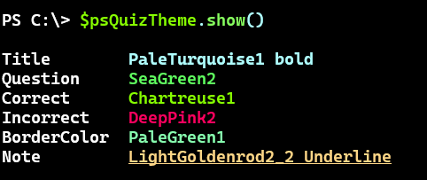
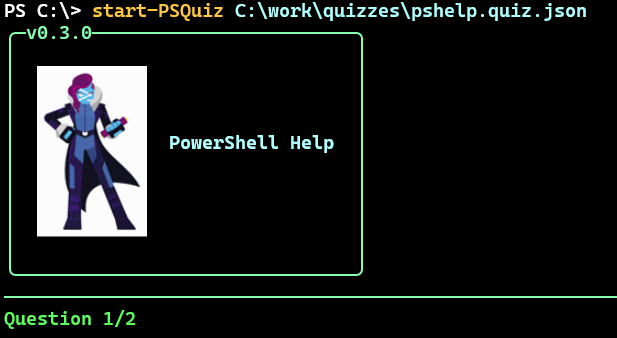
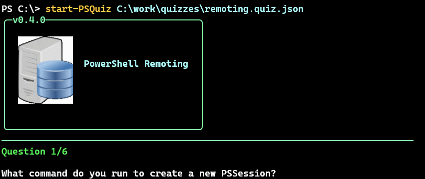
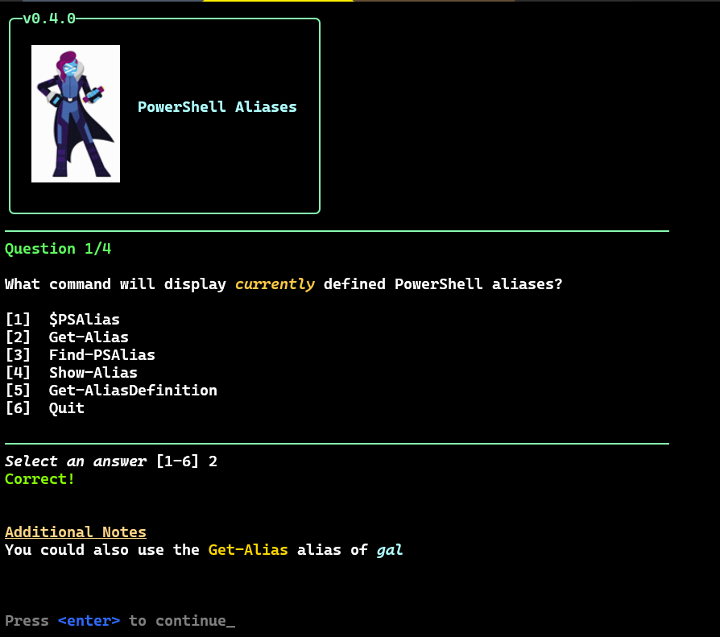
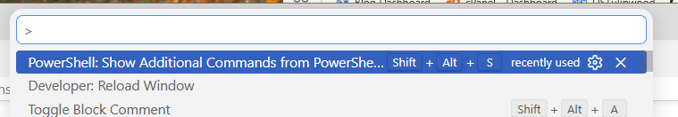
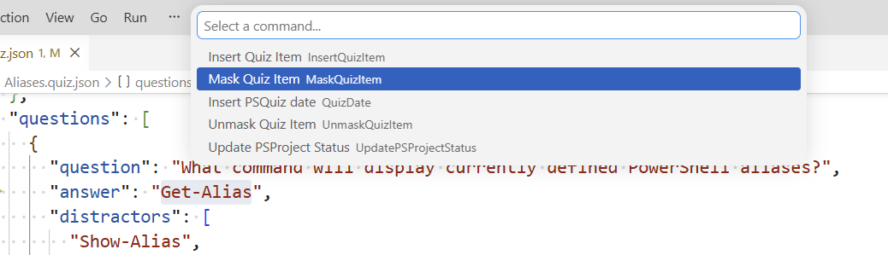
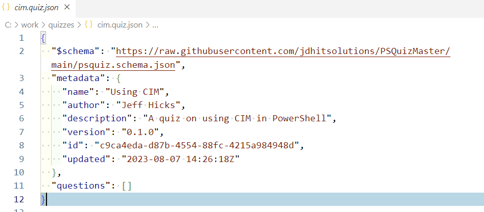
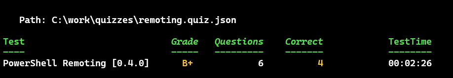
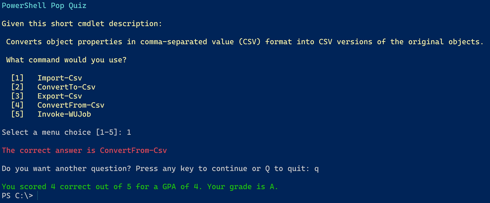

# PSQuizMaster

[](https://www.powershellgallery.com/packages/PSQuizMaster/) [](https://www.powershellgallery.com/packages/PSQuizMaster/)


This PowerShell module consists of two parts, commands to generate quizzes or testing material, and commands for taking a quiz. Quiz files are stored as JSON documents. As of version 2.0.0, this module requires a PowerShell 7 platform. If you must use Windows PowerShell, install version 1.3.0 from the PowerShell Gallery, although that version lacks new features such as the DSL and theme support.

## Installation

The recommended installation is through the PowerShell Gallery.

```powershell
Install-Module PSQuizMaster
```

or

```powershell
Install-PSResource PSQuizMaster -Repository PSGallery -TrustRepository
```

## Module Commands

| Name | Alias | Synopsis |
| ------ | ------- | ---------- |
| [Copy-PSSampleQuiz](docs/Copy-PSSampleQuiz.md) | | Copy module sample quiz files. |
| [Get-PSQuiz](docs/Get-PSQuiz.md) | | Get quizzes from the default quiz path. |
| [Invoke-PSQuickQuiz](docs/Invoke-PSQuickQuiz.md) | | Run a PowerShell quiz |
| [Invoke-PSQuiz](docs/Invoke-PSQuiz.md) | *Start-PSQuiz* | Start a PowerShell quiz |
| [New-PSQuiz](docs/New-PSQuiz.md) | *Make-PSQuiz* | Create a new quiz. |
| [New-PSQuizFile](docs/New-PSQuizFile.md) | | Create an empty quiz file |
| [New-PSQuizFixture](docs/New-PSQuizFixture.md) | | Create a new PSQuiz fixture script |
| [New-PSQuizQuestion](docs/New-PSQuizQuestion.md) | | Create a new quiz question. |
| [Protect-PSQuizFile](docs/Protect-PSQuizFile.md) | | Mask answers and distractors in a PSQuiz file. |
| [Question](docs/Question.md) | | A PSQuiz DSL command to create a quiz question |
| [Quiz](docs/Quiz.md) | | A PSQuiz DSL command to define a quiz |
| [Remove-PSQuizSetting](docs/Remove-PSQuizSetting.md) | | Remove the PSQuizPath settings file. |
| [Set-PSQuizFile](docs/Set-PSQuizFile.md) | | Update a quiz file. |
| [Set-PSQuizPath](docs/Set-PSQuizPath.md) | *Save-PSQuizSettings* | Save the user's PSQuizPath and psQuizTheme settings to a file. |
| [Unprotect-PSQuizFile](docs/Unprotect-PSQuizFile.md) | | Unmask answers in a PSQuiz file. |
| [Update-PSQuizSchema](docs/Update-PSQuizSchema.md) | | Update the schema for a PSQuiz file. |

Most commands should work cross-platform.

Beginning with v2.0.0, the [pwshSpectreConsole](https://pwshspectreconsole.com/) module is now a dependency and will be installed from the PowerShell Gallery if not found.

## Design

Quizzes are stored as JSON files. Each quiz has a set of questions which includes a set of distractors. You can add a note to each question to provide additional insights or information.

The module commands will look for quiz files in the location defined in the global variable `$PSQuizPath`. The default value is the `Quizzes` folder in the module directory.

## Creating a Quiz

The easiest way to create a quiz is to use the `New-PSQuiz` command. This will guide you through the process of creating a quiz file.

```powershell
PS C:\> New-PSQuiz
What is the full name of your quiz?: PowerShell Remoting
What is the short quiz name? This will be used as part of the file name: remoting
Enter a quiz description. You can always edit this later: A short quiz on PowerShell remoting
Enter the author name: Jeff Hicks
Enter the question: What command should you run to enter an interactive remoting session?
Enter the answer: Enter-PSSession
Enter a comma-separated list of distractors: New-PSSession,New-CimSession,Enter-CimSession,Winrm
Enter any notes for this question: Do not confuse PSSessions with CimSessions.
Add another question? (Y/N): y
Enter the question: What is the default PowerShell remoting port?
Enter the answer: 5985
Enter a comma-separated list of distractors: 5986,22,80,443
Enter any notes for this question: When using SSL, the default port will be 5986.
Add another question? (Y/N): n

Name        : PowerShell Remoting
Author      : Jeff Hicks
Version     : 0.1.0
Description : A short quiz on PowerShell remoting concepts.
Questions   : 2
Updated     : 6/19/2026 10:21:21 AM
Path        : C:\Scripts\PSQuizMaster\quizzes\remoting.quiz.json
```

This will create this JSON file.

```JSON
{
    "$schema": "https://raw.githubusercontent.com/jdhitsolutions/PSQuizMaster/main/psquiz.schema-v2.json",
  "metadata": {
    "name": "PowerShell Remoting",
    "author": "Jeff Hicks",
    "description": "A short quiz on PowerShell remoting concepts.",
    "version": "0.1.0",
    "id": "32248289-3ca9-4fb6-acde-524c809bf50e",
    "updated": "2026-06-19 14:21:21Z"
  },
  "logo": "",
  "questions": [
    {
      "question": "What command should you run to enter an interactive remoting session?",
      "answer": "Enter-PSSession",
      "distractors": [
        "New-PSSession",
        "New-CimSession",
        "Enter-CimSession",
        "Winrm"
      ],
      "note": "Do not confuse PSSessions with CimSessions."
    },
    {
      "question": "What is the default PowerShell remoting port?",
      "answer": "5985",
      "distractors": [
        "5986",
        "22",
        "80",
        "443"
      ],
      "note": "When using SSL, the default port will be 5986."
    }
  ]
}
```

Quiz files should follow the naming convention of `<shortname>.quiz.json`.

You can also use the `New-PSQuizFile` command to create a quiz file and then use `New-PSQuizQuestion` to create questions. Add the questions to the file using [`Set-PSQuizFile`](docs/Set-PSQuizFile.md).

## Protecting Quizzes

Because quizzes are stored as plaintext JSON files, the answers are easily discovered. If you want to deter casual "cheating" you can use `Protect-PSQuizFile` to mask the answers. The technique used to hide the answer isn't complicated or fancy. You can use `Unprotect-PSQuizFile` to revert the process. Version 1.3.0 and later of this module also protects distractors.

When you run the these commands, a new JSON metadata setting called `protected` will be set.

Even though you can mask individual questions, it is recommended that if you want to hide the answer, then protect the entire file. You can use the VSCode editor integrations to mask and unmask individual items.

## Quiz Theming and Style

Version 2.0 added the pwshSpectreConsole module as a dependency to make it easier to support themes and styles. Earlier versions of the module used console colors with `Write-Host` to display quiz elements such as the title and notes. Now, when you import the module, a `PSQuizTheme` object is created and saved as the global variable `$PSQuizTheme`.

```powershell
PS C:\> $PSQuizTheme

Title       : PaleTurquoise1 bold         #The quiz title style
Question    : SeaGreen2                   #The question number style
Correct     : Chartreuse1                 #The style for Correct
Incorrect   : DeepPink2                   #The style for Incorrect
BorderColor : PaleGreen1                  #The border and horizontal line color
Note        : LightGoldenrod2_2 Underline #The note header style
DefaultLogo : C:\scripts\PSQuizMaster\assets\MsPowerShell.jpg
```

The object has a method called `Show()` which will display the SpectreConsole values using the corresponding values.



You can modify any of the properties using any valid SpectreConsole color that you see with `Get-SpectreDemoColors`. If you want to include a style add it like this:

```powershell
$PSQuizTheme.title = "LightSteelBlue1 Italic"
```

To keep them as your default, run `Set-PSQuizPath` or its alias `Save-PSQuizSettings` to store them in the settings JSON file.

You can use SpectreConsole styles in your quiz file to add emphasis. Don't forget the closing `[/]`.

```JSON
 {
  "question": "What PSDrive shows PowerShell aliases?",
  "answer": "Alias",
  "distractors": [
    "A:",
    "$Alias",
    "psalias",
    "$PSAliasDrive"
  ],
  "note": "Remember,the drive name [fuchsia italic]does not[/] include the colon (:)."
}
```

> *If you want to protect your quiz, add style settings before masking items.*

### Logo Images

Quizzes now display a formatted quiz header with a default image displayed inside a panel. The quiz title will be displayed at about the center of the image. All quizzes will use a default logo from the module.



However, you can define a logo image on a __per-quiz__ basis by editing or adding the `logo` property.

```JSON
"questions": [
],
"logo": "c:\\scripts\\db.png"
```

The value must be the full path to the image file. You should avoid using variables and PSDrives. Remember to escape the slashes in JSON.

Note that the image will be scaled to a maximum width of 10.



If the image file is not found or defined, the default module logo will be used.

### Design Recommendations

When using `New-PSQuizQuestion` or `New-PSQuiz`, __do not__ include SpectreConsole styling in your questions and answers. Manually add styling after creating the quiz by editing the JSON file. One thing to be careful of is that if any part of your quiz uses square brackets, like `[DateTime]`, in the JSON file it must be saved as `[[DateTime]]`.

When you run a quiz, it will use the settings in `$PSQuizTheme` and any settings in the quiz JSON file.



> *You can control the panel border and horizontal line colors by setting the `BorderColor`*.

## Using the DSL

A Domain Specific Language (DSL) was added to version 2.0.0. The DSL has two commands to make it easier to create a quiz file. The concept is that you create a PowerShell script using the DSL that when executed will create the quiz JSON file.

To simplify the process even further, you can run [`New-PSQuizFixture`](docs/New-PSQuizFixture.md) to create the DSL script file outline.

```powershell
New-PSQuizFixture -Name "PowerShell 7 Basics Quiz" -Path c:\temp\ps7quiz.ps1 -questions 5 -Protect
```

The command will create this PowerShell script file.

```powershell
#requires -version 7.6
#requires -module PSQuizMaster

#This is a fixture for a new quiz file

#usage: c:\temp\ps7quiz.ps1

<#
  Use -protect to mask all answers, distractors, and notes
  Do not include SpectreConsole formatting in the quiz data
  here. You also can insert formatting in the quiz JSON file.
  You also do not need to escape square brackets. That will
  be handled when the JSON file is created.
#>

Quiz 'PowerShell 7 Basics Quiz' -protect @(
    @{
        Path        = # specify the full path to the quiz JSON file, e.g. c:\quizzes\subject.quiz.json
        Author      = Jeff
        Description = # add a meaningful one-line description
    }
    Question  @{
        Question    = #What is your question
        Answer      = #what is the correct answer
        Distractors = #enter a comma-separated list of distractors
        Note        = #enter an optional note with more information
    }
    Question  @{
        Question    = #What is your question
        Answer      = #what is the correct answer
        Distractors = #enter a comma-separated list of distractors
        Note        = #enter an optional note with more information
    }
    Question  @{
        Question    = #What is your question
        Answer      = #what is the correct answer
        Distractors = #enter a comma-separated list of distractors
        Note        = #enter an optional note with more information
    }
    Question  @{
        Question    = #What is your question
        Answer      = #what is the correct answer
        Distractors = #enter a comma-separated list of distractors
        Note        = #enter an optional note with more information
    }
    Question  @{
        Question    = #What is your question
        Answer      = #what is the correct answer
        Distractors = #enter a comma-separated list of distractors
        Note        = #enter an optional note with more information
    }

    <#
        You can delete Note if not used
        At least 4 distractors are recommended
        You can delete this comment
    #>
)
```

All you need to do is define the quiz metadata and the questions.

If you import the module in the VS Code integrated editor and run `New-PSQuizFixture`, you can use the dynamic parameter `-UseEditor` which will open the new file in VS Code.

Read the help topic [about_PSQuizDSL](docs/about_PSQuizDSL.md) to learn more on using the DSL.

## Editor Integrations

The module includes several editor-related features that you might find helpful. Especially if you find it easier or faster to create a quiz file by editing the JSON file directly. To use, you must __import this module__ in the integrated VSCode terminal running PowerShell 7.6 or later.

### Schema

The JSON file includes a public schema. If you open the quiz JSON file in VS Code, you can get tab completion and assistance in adding questions to the file or adjusting the metadata. There is no reason to remove the schema reference in the file.

#### Updating to Version 2

Version 2.0 of this module introduced new features and a new schema version. Quizzes created with this version of the module will use the new schema. If you have existing quizzes, you may want to update the schema. There are several options.

First, if you protect with `Protect-PSQuizFile` or unprotect with `Unprotect-PSQuizFile`, the schema setting automatically be updated to v2.

Your other option is to use the [`Update-PSQuizSchema`](docs/Update-PSQuizSchema.md) command. In addition to updating the schema setting, you can opt to the `protected` metadata setting and the new `logo` setting. You should verify the `protected` setting is accurate. You will need to manually enter to complete path to the logo image file.

If you update the schema, you should update the internal version number of your quiz.

### Editor Shortcuts

The other editor shortcuts are intended for users who want to edit the JSON quiz file directly.

Open a quiz JSON file and then open the VSCode command palette (Ctrl+Shift+S). Select `PowerShell Show Additional Commands...`



You will then see a menu of commands added to VSCode. In the JSON file select an answer, distractor, or note. You can manually mask the item.



Follow the same process to unmask using the `Unmask Quiz Item` command. Although if you are masking and unmasking in the same editing session, use the `Ctrl+Z` shortcut to toggle. If you encounter problems, you can use the command palette to reload the window, which will also force you to re-import the module. Or restart VSCode.

When editing a quiz JSON file, the `Updated` property needs to follow a specific format. In the JSON metadata, you can select the `updated` value and use the `Insert PSQuiz date` integrated command.

> In previous module versions that support Windows PowerShell, when using the PowerShell ISE, importing this module will create an Add-ons menu called `Insert Quiz UTC Date` that will achieve the same result.

You can also manually add the JSON for a new question directly in the file using `Insert Quiz item`. The command will insert this JSON at your cursor.

```JSON
    {
    "question" : "<enter your question>",
    "answer" : "<the correct answer>",
    "distractors" : [
        "<distractor #1>",
        "<distractor #2>",
        "<distractor #3>",
        "<distractor #4>"
        ],
    "note" : "<enter an optional note or delete this line>"
    }
```

Don't forget to manually insert commas as necessary.

These commands are for advanced users who want to modify the JSON file directly.

### UseEditor

When using this module in the PowerShell (v1.3.0) or VS Code, when running [`New-PSQuiz`](docs/New-PSQuiz.md) or [`New-PSQuizFile`](docs/New-PSQuizFile.md), you can use the `UseEditor` dynamic parameter. This will open the quiz JSON file in the current editor.

```powershell
New-PSQuizFile -Name "Using CIM" -ShortName cim -Path c:\work\quizzes -Author "Jeff Hicks" -Description "A quiz on using CIM in PowerShell" -UseEditor
```



You could then use code like this to generate quiz questions.

```PowerShell
 New-PSQuizQuestion | ConvertTo-JSON | Set-Clipboard
```

Paste the question into the JSON file and repeat.

## PSQuizMaster Settings

The default quiz location is determined by the value of the global `$PSQuizPath` variable. If you don't want to be constantly updating this variable every time you import the module, you can run `Set-PSQuizPath` and specify a new location.

```powershell
Set-PSQuizPath c:\work\quizzes
```

This will create a file under $HOME called `.psquizsettings.json` The path will be stored in this file. The next time you import the module, if this file exists, the module will use the saved location. You should not need to edit or do anything with this file. If you want to remove it, you should use `Remove-PSQuizSetting` which will delete the settings file and set the value of `$PSQuizPath` back to the module default.

If the settings JSON file does not exist, the value will be set to the `Quizzes` folder under the module. If you don't want to use the settings file, import the module in your profile script and then set a new value for `$PSQuizPath`.

Beginning with version 2.0.0, the module also supports style customizations through the pwshSpectreConsole module. A new hashtable, $psQuizTheme, is created when you load the module. You can manually change theme settings. Running this command will also save the theme settings to the JSON file. The next time you import the module, the saved theme settings will also be imported.

This command has an alias of `Save-PSQuizSettings` to reflect this change in functionality.

## Sample Quizzes

The module contains several sample quizzes you can find in the [Quizzes](quizzes) folder. If you don't change the value of `$PSQuizPath` you should be able to find them with `Get-PSQuiz`.

If you have changed the default path location, you can use `Copy-PSSampleQuiz` to copy the samples to the new destination.

## Taking a Quiz

To take a quiz, use `Invoke-PSQuiz`. You need to specify the full path to the JSON file. By default, the function will tab-complete quiz files found in `$PSQuizPath`.


The quiz is presented interactively. Questions and answers are presented in random order.

When you are done, you will see a summary of your results.



## PSQuickQuiz

The module contains a command to dynamically generate a quiz based on commands found in one or more modules. This is a great way to test your knowledge of PowerShell commands.

```powershell
PS C:\> Invoke-PSQuickQuiz -Module Microsoft.PowerShell.*
```

This will generate a dynamic quiz based on the commands found in the specified modules.



## Ideas and Project Road Map

- Check for the latest version of questions from a GitHub repository or path, including a UNC.
- Store long-term test results somewhere. Maybe use a database like SQLite, or maybe a JSON file.
- Create WPF or TUI front-ends for creating and taking quizzes.

## Related Modules

This module was created with PowerShell beginners in mind. You might also be interested in the [PSIntro](https://github.com/jdhitsolutions/PSIntro) module. The module includes a command to display a welcome splash screen of useful links. The module also includes a set of interactive tutorials on fundamental PowerShell topics.
